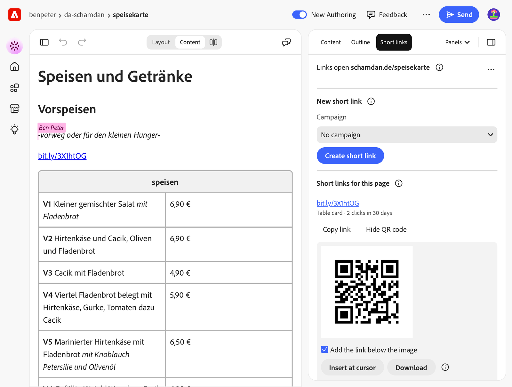

# Short links for Experience Workspace

A plugin for [Adobe Experience Workspace](https://da.live) (DA). Authors use it to
make short links and QR codes for the page they are editing, with a campaign for
each use: a table card, a flyer, an Instagram bio, a newsletter. The panel shows how
often each link was clicked in the last 30 days, and authors can put the QR code
straight into the page.

The links come from [Bitly](https://bitly.com). Each author connects their own Bitly
account. This plugin is not made or endorsed by Bitly.



This README is for site admins who want to add the plugin to a site. For how to use
it, see the [author guide](docs/authors.md).

## Before you start

- **A DA site with a published domain.** Links point to the published page, so the
  site needs its production host set as `cdn.prod.host` in the
  [site configuration](https://www.aem.live/docs/config-service-setup). Without it
  the panel shows a warning and doesn't create links.
- **The classic DA setup.** The plugin also handles sites on the new AEM API
  (Helix 6), but it is only tested on classic DA sites.
- **A Bitly account for each author.** Bitly's terms don't allow sharing access
  credentials, so there is no site-wide account. Use a paid plan: Core ($10 a month,
  billed yearly) has 100 links a month and 30 days of clicks. See
  [Bitly's pricing](https://bitly.com/pages/pricing).

  The free plan ("Free With Ads") isn't fit for links your visitors use. Bitly
  [shows an ad page](https://support.bitly.com/hc/en-us/articles/32874287800333-Why-are-there-ads-on-my-links)
  before every link of a free account: a cookie consent dialog for Bitly's ad
  partners, a preview of the destination and an ad, then a redirect after 8 seconds.
  That page also appears when someone scans the QR code. Links of paid accounts go
  straight to the page. The free plan also has only 5 links a month and no click
  counts.
- **Write access to the site** for authors who insert QR codes. The image is saved
  in the page's folder, like any image an author adds.

## Add it to a site

1. Open the site config: `https://da.live/config#/{org}/{site}/`.
2. In the `library` sheet (add a tab called `library` if there is none), add a row:

   | title | path | icon |
   |---|---|---|
   | Short links | `https://main--ew-bitly--benpeter.preview.da.live/tools/bitly/bitly.html` | `https://main--ew-bitly--benpeter.preview.da.live/tools/bitly/icon.svg` |

   Leave `ref`, `experience` and `format` empty. The plugin opens as a side panel.
   The title is the name authors see in the Panels menu. Any name works, as long as
   no other library row uses it.
3. Save the config.
4. Open a page of the site in Workspace. "Short links" is now in the **Panels** menu
   under Extensions.
5. Send your authors the [author guide](docs/authors.md). Each author pastes their
   Bitly token once.

To remove the plugin, first ask authors to remove their token (**⋯** > **Remove
Bitly token**), then delete the row. Without the row they can't open the panel to
remove it. Links stay in their Bitly accounts.

### Run your own copy

The row above loads the code from this repository. Changes here go live for your
authors without review, and the code can read their Bitly token. To review updates
first, fork the repository, install
[AEM Code Sync](https://github.com/apps/aem-code-sync/installations/new) on the fork,
and set:

- `path`: `https://main--{repo}--{owner}.preview.da.live/tools/bitly/bitly.html`
- `icon`: `https://main--{repo}--{owner}.preview.da.live/tools/bitly/icon.svg`

The token is stored per web address, so authors paste it again after the switch.

## What data goes where

- **The Bitly token** stays in the author's browser, in local storage of the
  plugin's web address, together with the author's Bitly group ID. Every site that
  loads the plugin from the same address shares it. The plugin sends the token only
  to Bitly's API (`api-ssl.bitly.com`). It never goes to Adobe or into the site
  config.
- **Bitly gets** the published URL of the page, the page path as the link title
  and, if the author picks a campaign, its name, `utm_source` and `utm_medium`. The
  links are in the author's Bitly account.
- **Adobe's APIs** are called with the author's Workspace sign-in, the same way the
  editor does: to read the site's published domain and to save inserted QR images.
- **The QR code** is drawn in the browser. It encodes the short link, so scans count
  as clicks, and it uses none of the QR codes in the Bitly plan.
- **The site gets** the QR image when an author inserts it, saved in the page's
  folder, for example `/.speisekarte/qr-bit-ly-3x1htog.png`.

## Limits

- Insert at cursor is tested in the editor's Content view, not in Layout.
- Pages under `/drafts/` aren't public. The panel shows a warning on these pages but
  still makes links.
- Authors should publish the page before they share a code.
- The QR image has no alt text. Authors add it in the editor after they insert it.
- Click counts show for the 10 newest links of a page.
- The campaigns are fixed:

  | Campaign | `utm_source` | `utm_medium` |
  |---|---|---|
  | Table card | `table-card` | `print` |
  | Flyer | `flyer` | `print` |
  | Instagram | `instagram` | `social` |
  | Newsletter | `newsletter` | `email` |

## Marketplace

The [Workspace marketplace](https://da.live/marketplace) lists extensions with a
short description and a link to their docs. A listing installs nothing: each site
still needs the library row above.

`marketplace/row.json` has the values for a listing (title, description, owner,
logo, card image), in the columns of the marketplace list. Adobe maintains the list,
and all current entries are Adobe's own. There is no public way to submit an entry
yet; ask the Experience Workspace team.

## Develop

```sh
npm ci
npm test
npm run lint
```

`test/fixtures/panel.html` runs the panel with a fake Workspace SDK and a fake
Bitly. Serve the repository root (for example `python3 -m http.server 6789`) and
open `/test/fixtures/panel.html`. Query parameters: `token=none`, `host=`,
`host=fail`, `path=/`, `bitly=monthly`, `ui=none`.

To try a local copy in Workspace, add a library row titled `Short links (local)`
with path `/tools/bitly/bitly.html` and ref `local`, run `aem up`, and open Workspace
with `?ref=local`. Workspace loads paths that start with `/` from
`http://localhost:3000` for `local` rows.

`marketplace/card.png` (1200x720) is made from `marketplace/card.html`:

```sh
python3 -m http.server 6789 &
"/Applications/Google Chrome.app/Contents/MacOS/Google Chrome" --headless=new \
  --hide-scrollbars --force-device-scale-factor=1 --window-size=1200,720 \
  --virtual-time-budget=3000 --screenshot=marketplace/card.png \
  http://127.0.0.1:6789/marketplace/card.html
```

## Licenses

Apache-2.0, see [LICENSE](LICENSE). `tools/bitly/vendor/qrcode.js` is
[qrcode-generator](https://github.com/kazuhikoarase/qrcode-generator) 2.0.4 by
Kazuhiko Arase, MIT license, see [tools/bitly/vendor/LICENSE-qrcode](tools/bitly/vendor/LICENSE-qrcode).
Bitly is a trademark of Bitly, Inc.
