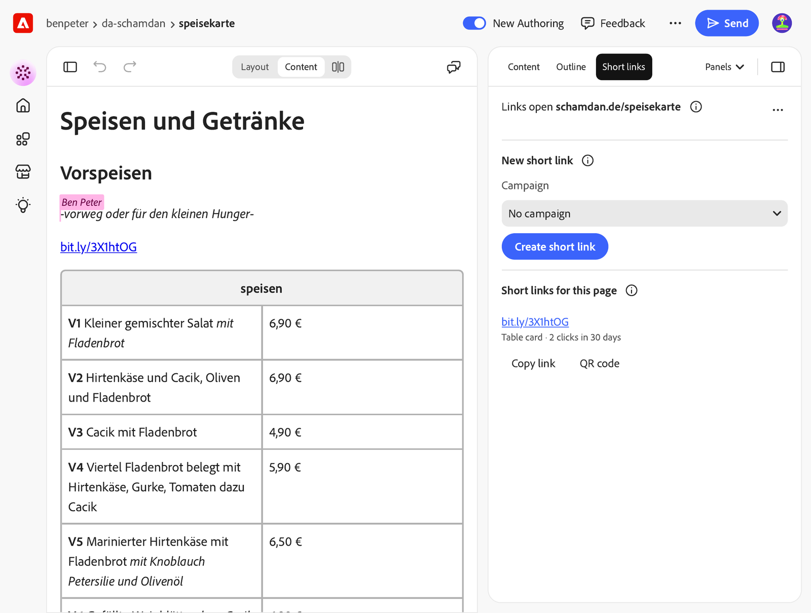
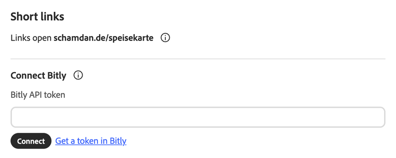
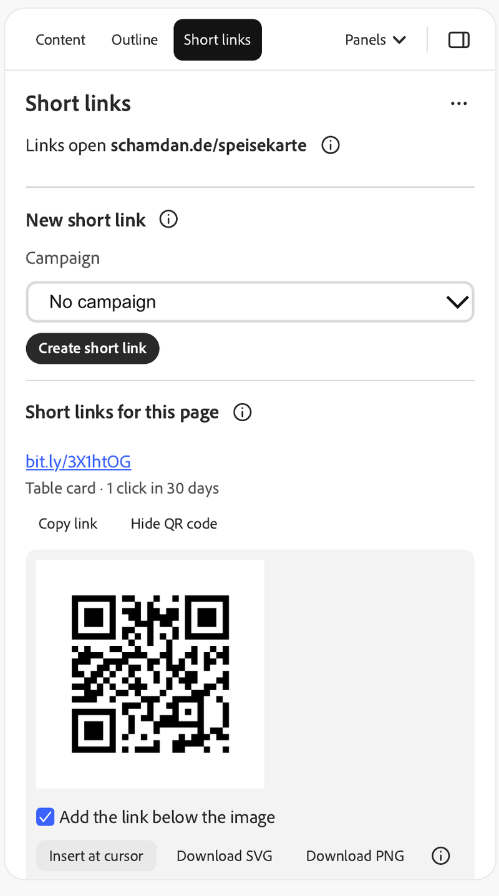
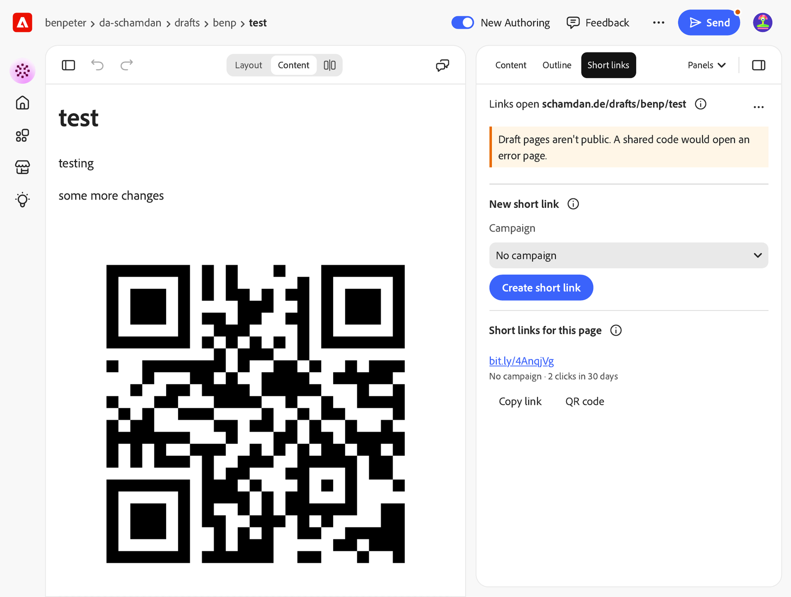
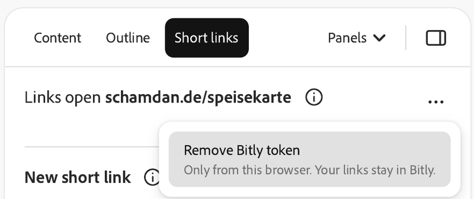

# Short links: author guide

The Short links panel makes short links and QR codes for the page you are editing.
Use them for print and social: a QR code on a table card, a flyer or a poster, a
short link in an Instagram bio or a newsletter. Each link can carry a campaign, so
your analytics can tell the table card from the flyer.

The links come from your own [Bitly](https://bitly.com) account. Use a paid Bitly
plan: on the free plan, Bitly shows visitors an ad page with an 8-second countdown
before every link and every QR code scan.

## Open the panel

Open a page in Workspace, then choose **Panels** > **Short links** in the right-hand
panel.

If Short links isn't in the menu, ask your site admin to add it.

## Connect your Bitly account (once)

1. In Bitly, open **Settings** > **API** and generate a token. The panel's
   **Get a token in Bitly** link opens that page.
2. Paste the token into **Bitly API token** and choose **Connect**.

The token stays in this browser. On another computer or browser, connect again.

## Make a short link

1. Pick a **Campaign**, or leave **No campaign**.
   - Table card and Flyer are for print, Instagram for social, Newsletter for email.
2. Choose **Create short link**.

The new link shows under **Short links for this page** with its campaign. Clicks of
the last 30 days show the next time you open the panel, for your 10 newest links.
Bitly's free plan has no click counts.

If you already have a link for this page and campaign, the panel says "You already
have this link." and shows its QR code instead of making a new one.

Choose **Copy link** to copy a short link, for example for an Instagram bio.

Each link counts against your Bitly plan (for example 100 links a month on Core).

## Get the QR code

Choose **QR code** under a link.

Then:

- **Insert at cursor** puts the QR image into the page where your cursor is. With
  **Add the link below the image** checked (the default), the short link goes below
  the image as a link. Switch the editor to **Content** (the Layout/Content switch
  above the page) first.
- **Drag** the QR code into the page, if your Workspace supports it.
- **Download SVG** for print, or **Download PNG**.

After inserting, add alt text to the image in the editor.

## Things to know

- The code opens the published page. Publish the page before you print the code.
- Pages under `/drafts/` aren't public. The panel shows a warning, because a printed
  code would open an error page.

  

- Scanning the QR code counts as a click on the link. Click counts can lag by a few
  minutes.
- The (i) buttons next to each heading tell you more.

## Remove your token

Choose the **⋯** button next to the panel title, then **Remove Bitly token**. This
removes the token from this browser only. Your links stay in Bitly.

Do the same if Bitly stops accepting your token, then connect with a new one.

